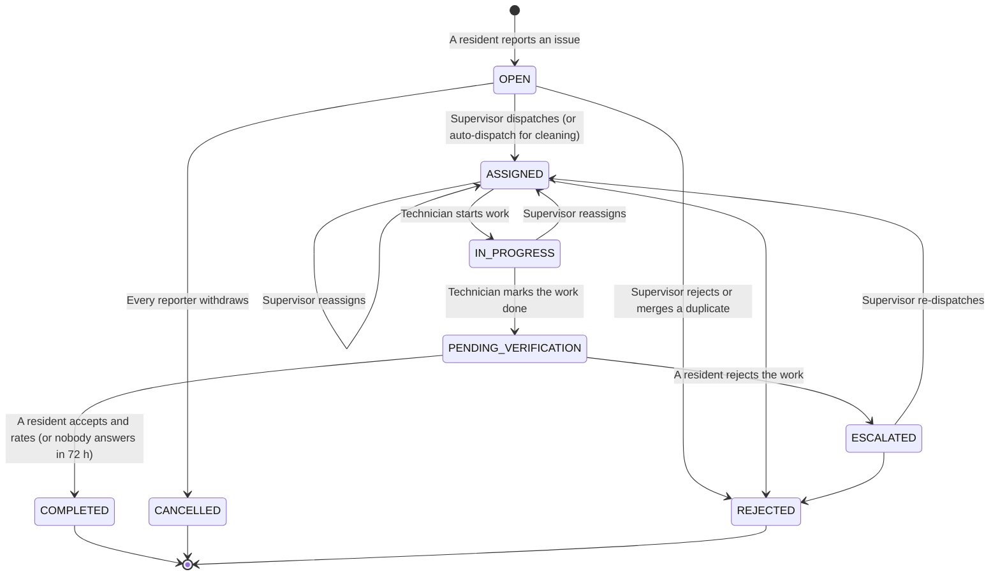
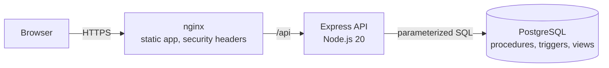

<div align="center">


# FixMaster

**Hostel facilities management and maintenance service desk**

Students report a fault once. FixMaster routes it to the right technician, orders their
work floor by floor, and closes the ticket only after the student confirms the fix.

[](https://github.com/Divyakush2006/FixMaster/actions/workflows/ci.yml)


</div>

---

## Contents

- [Overview](#overview)
- [Features](#features)
- [Ticket lifecycle](#ticket-lifecycle)
- [Shared tickets and concurrency](#shared-tickets-and-concurrency)
- [Architecture](#architecture)
- [Getting started](#getting-started)
- [Configuration](#configuration)
- [Database](#database)
- [API overview](#api-overview)
- [Security](#security)
- [Quality and testing](#quality-and-testing)
- [Project structure](#project-structure)
- [Documentation](#documentation)
- [Academic context](#academic-context)

## Overview

FixMaster replaces paper complaint registers in university hostels with a single,
auditable service desk. It is built for VIT Vellore's hostel blocks (A to T) and covers
the whole loop: intake, dispatch, on-site work, student verification and analytics.

| Problem in a paper-based process | How FixMaster handles it |
|---|---|
| Complaints get lost and nobody can see their status | Every ticket has a reference (`TKT-xxxxxx`), a live status and a full history |
| Technicians criss-cross a building between floors | Each technician's queue is ordered by floor, then priority |
| Roommates report the same fault separately, and two people get sent | The room is the unit: one live ticket per room (or common area) and issue, shared by everyone who reports it |
| Work is marked done without the resident agreeing | Only a resident of the room can close it; a rejection sends it back for rework |
| Supervisors cannot see recurring failures | Dashboards show open work, escalations and repeat-fault hotspots |
| No record of who changed what | Ticket history plus an append-only audit log of administrative actions |

## Features

**Students**
- Register and sign in with their registration number.
- Raise a ticket for their room or a common area, choosing from 6 categories and 25 issue types.
- If a roommate already reported the same thing, they are added to that ticket instead of opening a second one.
- See every ticket for their room, not only their own, and who reported it.
- Priority defaults from the issue type; a student can move it one level up or down at most.
- Follow each ticket on a timeline, then accept the fix with a rating or reject it. Any resident of the room can do this.
- Withdraw a request until a technician is assigned.

**Technicians**
- A work queue ordered by floor, then priority.
- Start a job, mark it done with a note, and set availability (on or off duty).
- Going off duty with open jobs asks whether to keep them or hand them back for reassignment.

**Automatic handling of every request**
- Each ticket gets a handling trail residents and supervisors can read: received, reviewed (by which AI model, or by the safety rules when none is available), then assigned automatically, suggested to a supervisor, or waiting with the reason (everyone off duty, at their limit ...). Tickets nobody can take are retried every minute and flagged to the supervisors after 30 minutes.
- The AI review can raise a priority (never above High, never lower it) and attaches reviewed safety advice until the fault is fixed.

**Two hostels** (men's and ladies')
- Each hostel has its own blocks, supervisors and chief warden. The men's hostel is blocks A to T except S; the ladies' hostel is A, B, C, D, E, F, G, H, J and S (ids `LA_BLOCK` ... `LS_BLOCK`, because both hostels have an A-Block). `MH` is the complete men's hostel and `PRP` an academic block: neither has rooms, only shared areas.
- A chief warden runs every block of their hostel and the academic blocks; a supervisor runs the blocks assigned to them (or all of their hostel's). Nobody sees or acts on the other hostel's tickets. Administrators run both.
- A resident is offered, and can only be allotted to, the hostel of their gender, and reports faults in their own hostel's shared areas or in an academic block.

**Supervisors and chief wardens**
- Block settings for the blocks they run: rename a block, add or remove floors, add or close rooms, and manage the shared areas (washrooms, lifts, corridors) residents can report faults in. A chief warden can also add blocks to their hostel; moving a block between hostels is the administrator's.
- A dashboard of key figures, a searchable and filterable ticket register, and an escalation queue.
- Dispatch tickets to a technician or reassign them. Cleaning requests can be auto-dispatched.
- If another supervisor changed the ticket while it was open on screen, the assignment is refused with who did it, instead of silently overriding them.
- Assigning an off-duty technician needs a confirmation; the dashboard flags jobs held by off-duty technicians.
- Reject a ticket that is not valid work (with a reason the reporters can see), or merge a duplicate into another ticket at the same location.
- Hotspots: locations with recurring faults.

**Administrators** (separate sign-in at `/admin`, shorter sessions)
- Users and access: create accounts, deactivate or reactivate them, unlock locked accounts and reset passwords.
- Room allotments, with live room occupancy.
- Infrastructure: blocks, floors and rooms, with floor-based numbering (`G01`, `428`).
- Audit log of every administrative change.

**Across the product**
- Responsive interface that works on phones for students and technicians.
- Meets WCAG 2.1 AA accessibility.
- Signs users out after a period of inactivity, and signing out in one tab signs out every tab.

## Ticket lifecycle



The database enforces these rules, not just the interface. Ticket transitions run inside
stored procedures that lock the row, and a trigger writes every status change to the
ticket's history. Every closed ticket records why it closed: confirmed, closed
automatically, withdrawn, rejected as invalid, or merged as a duplicate.

## Shared tickets and concurrency

A hostel room is shared, so the **room (or common area) is the unit of a ticket**, not
the person who reported it.

- **One live ticket per location and issue.** When a roommate asks for room cleaning that
  is already requested, they are added to the existing ticket and told when it was
  raised. A partial unique index enforces this in the database, so it also holds when two
  roommates tap at the same instant.
- **Everyone in the room sees it.** Residents see their room's live tickets and any raised
  since they moved in; they do not see a previous occupant's closed history.
- **Any resident can confirm the work.** The first answer counts; a second resident
  answering at the same moment is told who already did. Someone who has moved out keeps
  read access but can no longer confirm.
- **Nothing waits forever.** Work nobody confirms within 72 hours is closed automatically
  (`VERIFICATION_AUTO_CLOSE_HOURS`).
- **Common areas.** Twenty students reporting one broken water cooler produce one ticket
  with twenty reporters; at five reporters its priority goes up one level (never to
  Emergency automatically).

Concurrent actions are made safe in the database rather than hoped for:

| Situation | Guarantee |
|---|---|
| Roommates submitting the same request together | Exactly one ticket; the others join it |
| Technician finishes a job while a supervisor reassigns it | No deadlock: every transaction locks the ticket before its assignments, and a rare deadlock or serialization failure is retried automatically |
| Two supervisors dispatching the same ticket | The second is refused with the name of who assigned it (optimistic concurrency) |
| Two cleaning tickets auto-dispatched at once | They go to different cleaners (workload decisions are serialized per trade) |
| Two residents confirming at once | One answer is recorded; the other is told who answered |

## Registration and room requests

A new student registers at `/register` with their name, registration number,
email, mobile number, a confirmed password, and the **block, floor and room**
they live in. The choices come from the hostel infrastructure the
administrators have configured (a block added in the admin portal appears at
once; with none configured the form says so).

The room is a **request, not proof of residence**. The server checks that the
room exists, is open and matches the chosen block and floor, then records the
request in the audit log in the same transaction as the account. The student
can sign in straight away but cannot raise room tickets, and can still report
common-area faults. The hostel office sees **Room requests** on the allotments
page and approves (through the normal allotment workflow, which enforces bed
capacity) or declines with a reason the student sees. Students can send a new
request after a decline. Public registration only ever creates students.

The database has no pending-allotment state and its structure is fixed, so
requests live in `audit_log` (`allotment.request` / `allotment.decline`) and a
pending request is derived from it. Limitation: a request cannot be withdrawn
or edited, only superseded by a newer one.

## Architecture



| Layer | Technology |
|---|---|
| Web app | React 18, TypeScript, Vite, Tailwind CSS, TanStack Query, React Hook Form + Zod, Recharts |
| API | Node.js 20+, Express 5, express-validator, Helmet, express-rate-limit, JSON Web Tokens, bcrypt |
| Database | PostgreSQL 15 / 16: stored procedures, triggers and views; versioned, checksummed migrations |
| Delivery | Docker images for the API and the web tier (nginx), Docker Compose, GitHub Actions CI |

The API talks to PostgreSQL through `pg` with parameterized queries; there is no ORM. The
business rules live in the database (`database/migrations/003_programmable_objects.sql` and
`006_dispatch_reassignment.sql`), so they hold no matter which client writes the data.

## Getting started

### Prerequisites

- Node.js 20 or newer (22 recommended)
- PostgreSQL 15 or newer, **or** Docker Desktop

### Run locally

```bash
git clone https://github.com/Divyakush2006/FixMaster.git
cd FixMaster

cp .env.example .env              # then put your local PostgreSQL password in DATABASE_URL
npm ci
npm run db:migrate                # create or upgrade the schema
npm run db:seed                   # load the VIT L-Block demo dataset
npm run dev                       # API on http://localhost:5000

cd client
npm ci
npm run dev                       # web app on http://localhost:3000
```

Open http://localhost:3000/login for students and staff, or http://localhost:3000/admin
for administrators.

### Accounts

There are no built-in or shared logins. Accounts are created with a random password each:

```bash
npm run db:provision -- --yes --admin-only      # a real deployment: just the first administrator
npm run db:provision -- --yes                   # a sample roster: 2 admins, 2 chief wardens, 12 supervisors,
                                                # 82 technicians and 200 residents (100 men, 100 women), with rooms
```

Both write a credentials file (`credentials/fixmaster-credentials-<time>.txt`, git-ignored, readable only by its
owner) with every ID, password and role. Add `--require-change` (on by default with `NODE_ENV=production`) to make
each person choose their own password at first sign-in. The script only creates what is missing, so it is safe to
repeat; `--rotate` issues new passwords. Sign in at `/login` (Student or Staff tab) or `/admin`.

The demo dataset of the course project (`npm run db:seed`, one shared password) still exists for local development and
the automated tests; it is refused when `NODE_ENV=production` and the sign-in pages never list it.

> No signing secret is shipped: generate your own `JWT_SECRET` per environment (with none set, local development
> uses a random one per run). In production the API refuses to start without a
> strong secret, and it rejects the secret published in this repository's early history.

### Run with Docker

```bash
cp .env.example .env    # set JWT_SECRET (32+ random characters), POSTGRES_PASSWORD and CORS_ORIGIN
docker compose up -d --build
```

The app is served on http://localhost:8080. The API container applies pending migrations
on start. Create the first administrator with `docker compose --profile setup run --rm provision` (the password is written
to `./credentials/admin-credentials.txt`; change it at first sign-in). To load demo data instead, run the one-shot `seed`
service (`docker compose --profile demo run --rm seed`).

## Configuration

All settings live in `.env`; see [`.env.example`](.env.example) for the full,
commented list. Only `DATABASE_URL` is required for local development; production also
requires a strong `JWT_SECRET` and `CORS_ORIGIN`. No credential is ever committed: `.env`
is git-ignored and `.env.example` holds placeholders only.

| Variable | Purpose | Default |
|---|---|---|
| `DATABASE_URL` | PostgreSQL connection string (TLS is enabled automatically for managed providers such as Neon) | local `fix_master_db` |
| `JWT_SECRET` | Signing key for session tokens; required (32+ random characters) in production | random per run in development |
| `JWT_EXPIRES_IN` / `JWT_ADMIN_EXPIRES_IN` | Session length for users and administrators | `24h` / `8h` |
| `CORS_ORIGIN` | Allowed web origin; required in production | none |
| `TRUST_PROXY` | Set when running behind a reverse proxy | off |
| `LOGIN_LOCKOUT_THRESHOLD` / `LOGIN_LOCKOUT_MINUTES` | Account lockout after repeated failed sign-ins | `10` / `15` |
| `RATE_LIMIT_*` | Request limits per user, per account and per IP | see `.env.example` |
| `VERIFICATION_AUTO_CLOSE_HOURS` | Close finished work nobody confirmed after this many hours | `72` |
| `VERIFICATION_SWEEP_MINUTES` | How often the auto-close check runs | `15` |
| `COMMON_AREA_PRIORITY_BUMP_AT` | Reporters needed to raise a common-area ticket's priority one level | `5` |

## Database

**16 tables.** The 11 core tables cover blocks, rooms, common areas, users, allotments,
complaint categories and sub-categories, complaints, assignments, feedback and ticket
logs. Five operational tables support them: `complaint_reporters` (everyone who reported a
shared ticket), `block_floors`, `audit_log`, `revoked_tokens` and `schema_migrations`. All users share one `users` table with a
`role` column (role-based access control).

**Programmable objects.** Stored procedures handle dispatch and reassignment, resolution
confirmation, cleaning auto-dispatch and closing unverified work. Triggers write the ticket
audit trail, register each ticket's first reporter, maintain timestamps and keep floor
counts in sync. Views produce the technician queue, the
supervisor summary and recurring-defect alerts.

| Command | What it does |
|---|---|
| `npm run db:migrate` | Apply pending migrations; refuses to run if an applied migration was edited |
| `npm run db:seed` | Load the demo dataset |
| `npm run db:reset -- --yes` | Drop and rebuild a **development** database |
| `npm run db:bundle` | Regenerate `database/schema.sql` and `triggers_procedures.sql` from the migrations |
| `database/backup_restore.sh backup` | `pg_dump` backup (PowerShell: `backup_restore.ps1`) |
| `database/backup_restore.sh restore <file>` | `pg_restore` from a backup |

> Never run `database/init_all.sql` against a database you want to keep: it drops every table.

## API overview

All endpoints are under `/api`. Responses are JSON, and list endpoints page with
`limit` / `offset` and return the total in the `X-Total-Count` header.

| Area | Base path | Who |
|---|---|---|
| Authentication | `/api/auth` (student register and login, staff login, admin login, logout) | Public / signed in |
| Tickets | `/api/complaints` (raise or join, list, detail, history; `withdraw`, `reject`, `merge`, `related`) | Students (their own and their room's), supervisors, administrators |
| Dispatch and work queue | `/api/dispatch` | Supervisors (assign, auto-dispatch), technicians (queue, start, done) |
| Verification | `/api/feedback` | A resident of the room (common areas: anyone who reported it) |
| Analytics | `/api/analytics` (KPIs, hotspots) | Supervisors, administrators |
| Reference data | `/api/meta` (blocks, floors, rooms, categories, staff) | Signed in |
| Own account | `/api/me` (profile, allotment, password, availability) | Signed in |
| Administration | `/api/admin` (users, allotments, blocks, floors, rooms, audit log) | Administrators |
| Health | `/api/health`, `/api/health/live` | Public |

## Security

- **Separate sign-in portals** for students, staff and administrators. Each token is bound
  to its portal, and administrator sessions are shorter.
- **Server-side sign-out.** Every token has a unique id and is revoked on sign-out; a
  password change invalidates all older sessions.
- **Brute-force protection.** Accounts lock after 10 consecutive failed sign-ins, and rate
  limits are counted per account, per user and per IP.
- **Password policy.** At least 8 characters with a letter and a digit, not a common
  password, and not containing the account ID. Passwords are stored as bcrypt hashes.
- **Authorization checks on every request.** Role checks, room-residency and reporter
  checks on tickets, and validation of all input. Every query is parameterized.
- **Machine-readable conflicts.** Expected conflicts (a stale screen, an off-duty
  technician, open jobs) return 409 with a stable `code`, so clients react precisely
  instead of showing a generic error.
- **Web tier hardening.** Content Security Policy, HSTS, `X-Frame-Options: DENY` and
  `nosniff`; the API uses Helmet and refuses weak production configuration.
- **Accountability.** An append-only audit log records each administrative action with the
  actor, target, IP address and request id.

Known limitations and recommended next steps are listed in
[Production Readiness](docs/PRODUCTION_READINESS.md#not-done--accepted-risks-and-decisions-for-the-team).

## Quality and testing

```bash
npm test                 # API and database tests (uses a separate fix_master_test database)
cd client && npm test    # web app unit tests
```

| Check | Result |
|---|---|
| API and database tests (Node test runner, real PostgreSQL) | 114 passing, including genuinely simultaneous requests and a deterministic deadlock regression test |
| Web unit tests (Vitest) | 30 passing |
| Browser end-to-end (Playwright: lifecycle, hardening, shared tickets) | All passing, no page errors |
| Security probe of the running system (auth, authorization, injection, races, brute force) | 40 / 40 |
| Accessibility (axe-core, WCAG 2.1 AA) | 21 / 21 screens, 0 violations |
| Load (50 concurrent connections) | About 600 authenticated req/s, p99 about 120 ms, 0 errors |
| Dependency audit (shipped dependencies) | 0 known vulnerabilities |

CI runs on every push and pull request to `main` and `dev`:

- **API:** the test suite against PostgreSQL 15 and 16, plus a dependency audit.
- **Web:** type-checking, tests and a production build.
- **Docker:** builds the full Compose stack and smoke-tests it through nginx.

## Project structure

```
.
├── src/                    Express API: routes, controllers, middleware, services
├── database/
│   ├── migrations/         Versioned schema, procedures, triggers and views
│   ├── seed_data.sql       Demo dataset (VIT L-Block)
│   └── backup_restore.*    pg_dump / pg_restore scripts
├── scripts/                Migrate, seed, reset and bundle tools
├── tests/                  API and database test suites
├── client/                 React web app (Vite) and its nginx config
│   └── src/
│       ├── features/       Screens by portal: student, staff, supervisor, admin
│       ├── components/     Design system and application shell
│       └── api/            Typed API client and session handling
├── docs/                   Design, audit and academic documentation
├── Dockerfile              API image
├── docker-compose.yml      db, api, web and seed services
└── .github/workflows/      CI pipeline
```

## Documentation

| Document | Contents |
|---|---|
| [Deploy: Cloudflare Pages + Render](docs/DEPLOY_CLOUDFLARE_RENDER.md) | Step-by-step production deployment, limits and troubleshooting |
| [Operations](docs/OPERATIONS.md) | Accounts, email, AI keys, photo storage, backups, first-deployment checklist |
| [Production Readiness](docs/PRODUCTION_READINESS.md) | Security audit, fixes, verification evidence and known limitations |
| [Bug Fix Log](docs/BUGFIXES.md) | Defects found and how they were fixed |
| [Frontend Notes](FRONTEND_NOTES.md) | Screens, routes and frontend conventions |
| [Database Implementation](docs/database_implementation.md) | DDL, joins, aggregates, triggers, procedures and views |
| [ER Diagrams](docs/er_diagrams.md) | Entity-relationship models and normalization proofs |
| [User Types](docs/user_types.md) | Roles and the permissions matrix |
| [Complaint Types](docs/complaint_types.md) | Categories, issue types and service-level targets |
| [Implementation Guide](docs/IMPLEMENTATION_GUIDE.md) | Team implementation guide |
| [Backend Handover Report](docs/BACKEND_HANDOVER_REPORT.md) | Backend engineering handover |

## Academic context

FixMaster was built for **BCSE307L, Database Systems** (B.Tech, Fall Semester 2026-27),
School of Computer Science and Engineering (SCOPE), VIT Vellore, under Dr. Deepika J.
The rubric-by-rubric mapping (problem statement, ER design, normalization, SQL
implementation, security and professional practices) is in the
[Academic Report](docs/ACADEMIC_REPORT.md).
