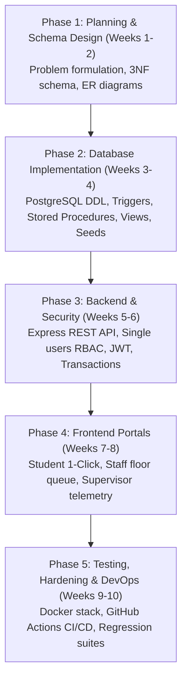
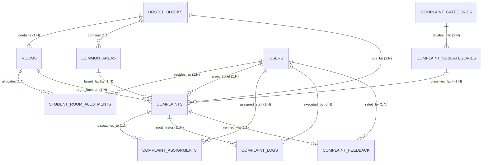

# FixMaster: Academic Report (BCSE307L Rubric Mapping)

> **Course Code**: BCSE307L – Database Systems | **Programme**: B.Tech (Fall Semester 2026-2027)  
> **Faculty**: Dr. Deepika J | School of Computer Science and Engineering (SCOPE), VIT Vellore  
> **Evaluation Rubric Compliance**: 30 Regular Marks + 3 Bonus Marks (Total: 33/30)

---

## 📑 Table of Contents (Rubric Section Mapping)

1. [Section 1: Problem Statement & Project Planning (2 Marks)](#section-1-problem-statement--project-planning-2-marks)
2. [Section 2: Database Design Requirements (6 Marks)](#section-2-database-design-requirements-6-marks)
3. [Section 3: Database Implementation (8 Marks)](#section-3-database-implementation-8-marks)
4. [Section 4: Application Development Requirements (4 Marks)](#section-4-application-development-requirements-4-marks)
5. [Section 5: Authentication, Authorization & Security (5 Marks)](#section-5-authentication-authorization--security-5-marks)
6. [Section 6: Professional Development Practices (5 Marks)](#section-6-professional-development-practices-5-marks)
7. [Section 7: Bonus Implementations (+3 Marks)](#section-7-bonus-implementations-3-marks)
8. [Cross-Reference Directory](#cross-reference-directory)

---

# Section 1: Problem Statement & Project Planning (2 Marks)

### 1.1 Project Title
**FIX_MASTER: An Intelligent Relational Database System for Multi-Tier Hostel Maintenance, Floor-Optimized Task Dispatch, and SLA Closed-Loop Verification**

### 1.2 Problem Statement
In dense residential university hostel blocks (such as VIT L-Block housing thousands of students across 10+ floors), maintenance operations suffer from:
1. **Manual Paper Logs**: Untracked paper slips leading to lost requests and lack of audit history.
2. **Spatial Routing Inefficiency**: Technicians wander randomly across floors rather than servicing clustered rooms.
3. **Absence of Resident Sign-off**: Staff mark complaints completed without resident verification or feedback.
4. **Common Amenity Blindspots**: Block supervisors lack real-time telemetry on recurring common area utility failures (water coolers, washroom pipe bursts, elevator glitches).

### 1.3 Objectives
- Architect a 3NF-normalized relational database covering room complaints, common facilities, multi-role users, dispatch queues, and feedback loops.
- Implement **1-Click Quick Action** for daily housekeeping and structured diagnostic ticketing for technical repairs (Electrical, AC, Carpenter, Plumbing).
- Automate floor-optimized task routing for service personnel.
- Enforce closed-loop verification where tickets cannot be closed without resident confirmation and rating.
- Provide block supervisors with real-time analytics, recurring defect telemetry, and SLA tracking.

### 1.4 Scope
- **Entities Covered**: All hostel rooms (e.g., `L-843`), common areas (floors 1–10), service staff, students, wardens, complaint categories, dispatch queues, and feedback logs.
- **Platform Scope**: Full-stack web application with responsive mobile/desktop interfaces.

### 1.5 Team Members & Responsibilities

| Team Member | Registration No. | Assigned Role | Primary Rubric Responsibilities |
|---|---|---|---|
| **Vihaan Varshney** | **24BAI0158** | **Database Architect & Data Engineer** | Relational schema design (3NF/BCNF), DDL scripts, Stored Procedures, Triggers, Database migrations, Native Backup/Restore scripts |
| **Divyakush Punjabi** | **24BCB0126** | **Full-Stack, Security & DevOps** | React Frontend UI, Express REST API, Single `users` table RBAC, JWT Authentication & BCrypt security, Docker & GitHub Actions CI/CD |
| **Sudeep Kumar Sahu** | **24BCT0160** | **AI Systems & Test Automation Engineer** | Gemini AI complaint triage & allocation service, System health monitoring & telemetry, Automated test suites & QA verification |

### 1.6 Technology Stack
- **Database Engine**: PostgreSQL 15 / 16 (relational, ACID-compliant).
- **Data Access Layer**: node-postgres (`pg`) with parameterized SQL queries; versioned, checksummed SQL migrations.
- **Backend API**: Node.js 20+ and Express 5.2 (REST API).
- **Frontend Client**: React 18, TypeScript, Vite, Tailwind CSS, TanStack Query.
- **Authentication**: JWT (HS256, per-portal audience, server-side token revocation) and BCrypt password hashing.
- **DevOps**: Docker, Docker Compose, nginx, GitHub Actions CI, `pg_dump`/`pg_restore`.

### 1.7 Major Deliverables
1. `database/schema.sql`: Core 11 tables + operational tables with PK, FK, CHECK, UNIQUE constraints and indexes.
2. `database/triggers_procedures.sql`: Audit triggers, auto-assignment procedures, and analytical views.
3. `database/seed_data.sql`: Realistic dataset for VIT L-Block: blocks, rooms, students, staff, categories, and tickets.
4. `database/backup_restore.sh` & `.ps1`: Native PostgreSQL backup and recovery scripts.
5. Full-stack application with Student, Staff, Supervisor, and Administrator portals.
6. CI/CD automation (`.github/workflows/ci.yml`), multi-stage Dockerfiles, and `docker-compose.yml`.

### 1.8 Project Timeline & Milestones



---

# Section 2: Database Design Requirements (6 Marks)

### 2.1 Entity Relationship (ER) Diagram
The system comprises **11 core entities** with 8 distinct relational associations enforcing referential integrity (`ON DELETE CASCADE` / `ON DELETE RESTRICT`):



### 2.2 Relational Schema (3NF / BCNF Normalized)
All tables satisfy **1NF** (atomic scalars), **2NF** (no partial dependencies on surrogate keys), and **3NF/BCNF** (no transitive dependencies):

1. **`hostel_blocks`** (`block_id` [PK], `block_name`, `total_floors`, `created_at`)
2. **`rooms`** (`room_id` [PK], `block_id` [FK], `room_number`, `floor_number`, `room_type`, `bed_capacity`, `is_active`)
3. **`common_areas`** (`area_id` [PK], `block_id` [FK], `floor_number`, `area_type`, `description`, `is_operational`)
4. **`users`** (`user_id` [PK], `reg_or_emp_id` [UK], `full_name`, `email` [UK], `phone_number`, `password_hash`, `role`, `specialization`, `is_available`, `failed_login_count`, `locked_until`)
5. **`student_room_allotments`** (`allotment_id` [PK], `student_id` [FK], `room_id` [FK], `academic_year`, `is_current`)
6. **`complaint_categories`** (`category_id` [PK], `category_code` [UK], `category_name`, `is_quick_action`, `default_sla_hours`)
7. **`complaint_subcategories`** (`subcategory_id` [PK], `category_id` [FK], `subcategory_code` [UK], `issue_name`, `estimated_resolution_mins`, `priority_level`, `required_specialization`)
8. **`complaints`** (`complaint_id` [PK], `ticket_scope`, `room_id` [FK], `common_area_id` [FK], `block_id` [FK], `raised_by_user_id` [FK], `subcategory_id` [FK], `description`, `status`, `priority`, AI audit columns)
9. **`complaint_assignments`** (`assignment_id` [PK], `complaint_id` [FK], `staff_user_id` [FK], `assigned_by_user_id` [FK], `assigned_at`, `current_state`, AI allocation columns)
10. **`complaint_feedback`** (`feedback_id` [PK], `complaint_id` [FK], `student_id` [FK], `is_satisfactorily_resolved`, `rating`, `student_comments`, `verified_at`)
11. **`complaint_logs`** (`log_id` [PK], `complaint_id` [FK], `changed_by_user_id` [FK], `previous_status`, `new_status`, `action_note`, `timestamp`)

*Supporting Operational Tables*: `block_floors`, `complaint_reporters`, `audit_log`, `revoked_tokens`, `schema_migrations`.

### 2.3 Data Dictionary
Field-by-field definitions, constraints, and data types are documented in [user_types.md](user_types.md) and [complaint_types.md](complaint_types.md).

### 2.4 Performance Indexes
```sql
CREATE INDEX idx_complaints_block_status ON complaints(block_id, status);
CREATE INDEX idx_complaints_room_id ON complaints(room_id);
CREATE INDEX idx_complaints_raised_by ON complaints(raised_by_user_id);
CREATE INDEX idx_assignments_staff_state ON complaint_assignments(staff_user_id, current_state);
CREATE INDEX idx_users_role_specialization ON users(role, specialization, is_available);
```

---

# Section 3: Database Implementation (8 Marks)

### 3.1 Database & 11 Related Tables
Implemented in native PostgreSQL 15/16 with strict constraint enforcement (`CHECK`, `UNIQUE`, `NOT NULL`, foreign key cascades). Partial unique indexes prevent duplicate open tickets for the same location and issue:
```sql
CREATE UNIQUE INDEX uq_live_room_issue ON complaints(room_id, subcategory_id) 
WHERE status NOT IN ('COMPLETED', 'REJECTED', 'CANCELLED') AND ticket_scope = 'ROOM';
```

### 3.2 CRUD Operations & Relational Joins
- **Create**: 1-click room cleaning or multi-field technical maintenance ticket.
- **Read / Joins**: Multi-table inner/outer joins across `complaints`, `users`, `rooms`, `complaint_subcategories`, and `complaint_assignments`.
- **Update**: Staff status updates (`ASSIGNED` → `IN_PROGRESS` → `PENDING_VERIFICATION`); student rating and closure.
- **Delete**: Soft deletes via `is_active` flags on rooms and users to maintain historical audit integrity.

### 3.3 Aggregate Queries & Analytical Views

#### 1. Floor-Optimized Staff Active Queue View
```sql
CREATE OR REPLACE VIEW view_staff_active_queue AS
SELECT 
    ca.assignment_id,
    ca.staff_user_id,
    c.complaint_id,
    c.ticket_scope,
    COALESCE(r.room_number, ca_area.description) AS location_identifier,
    COALESCE(r.floor_number, ca_area.floor_number) AS floor_number,
    c.priority,
    sub.issue_name,
    c.status,
    ca.assigned_at
FROM complaint_assignments ca
JOIN complaints c ON ca.complaint_id = c.complaint_id
JOIN complaint_subcategories sub ON c.subcategory_id = sub.subcategory_id
LEFT JOIN rooms r ON c.room_id = r.room_id
LEFT JOIN common_areas ca_area ON c.common_area_id = ca_area.area_id
WHERE c.status IN ('ASSIGNED', 'IN_PROGRESS')
ORDER BY floor_number ASC, c.priority DESC, ca.assigned_at ASC;
```

#### 2. Block Supervisor Analytics View
```sql
CREATE OR REPLACE VIEW view_block_supervisor_summary AS
SELECT 
    b.block_id,
    b.block_name,
    COUNT(c.complaint_id) AS total_complaints,
    COUNT(CASE WHEN c.status IN ('OPEN', 'ASSIGNED') THEN 1 END) AS pending_complaints,
    COUNT(CASE WHEN c.status = 'IN_PROGRESS' THEN 1 END) AS active_in_progress,
    COUNT(CASE WHEN c.status = 'PENDING_VERIFICATION' THEN 1 END) AS awaiting_student_confirmation,
    COUNT(CASE WHEN c.status = 'COMPLETED' THEN 1 END) AS resolved_count,
    COUNT(CASE WHEN c.ticket_scope = 'COMMON_AREA' THEN 1 END) AS common_area_issues
FROM hostel_blocks b
LEFT JOIN complaints c ON b.block_id = c.block_id
GROUP BY b.block_id, b.block_name;
```

### 3.4 Database Triggers (Automated Audit Logging)
```sql
CREATE OR REPLACE FUNCTION fn_audit_complaint_status_change()
RETURNS TRIGGER AS $$
BEGIN
    IF (OLD.status IS DISTINCT FROM NEW.status) THEN
        INSERT INTO complaint_logs (complaint_id, changed_by_user_id, previous_status, new_status, action_note)
        VALUES (NEW.complaint_id, NULL, OLD.status, NEW.status, 'Status updated via trigger');
    END IF;
    RETURN NEW;
END;
$$ LANGUAGE plpgsql;

CREATE TRIGGER trg_complaint_status_audit
AFTER UPDATE OF status ON complaints
FOR EACH ROW
EXECUTE FUNCTION fn_audit_complaint_status_change();
```

### 3.5 Stored Procedures & ACID Transactions
```sql
CREATE OR REPLACE PROCEDURE sp_confirm_resolution(
    p_complaint_id VARCHAR(36),
    p_student_id VARCHAR(36),
    p_rating INT,
    p_comments TEXT
)
LANGUAGE plpgsql
AS $$
BEGIN
    IF NOT EXISTS (
        SELECT 1 FROM complaints 
        WHERE complaint_id = p_complaint_id AND raised_by_user_id = p_student_id
    ) THEN
        RAISE EXCEPTION 'Unauthorized: Student did not raise this complaint.';
    END IF;

    INSERT INTO complaint_feedback (complaint_id, student_id, is_satisfactorily_resolved, rating, student_comments)
    VALUES (p_complaint_id, p_student_id, TRUE, p_rating, p_comments);

    UPDATE complaints 
    SET status = 'COMPLETED', closed_at = CURRENT_TIMESTAMP 
    WHERE complaint_id = p_complaint_id;

    UPDATE complaint_assignments 
    SET current_state = 'DONE', work_completed_at = CURRENT_TIMESTAMP 
    WHERE complaint_id = p_complaint_id;
END;
$$;
```

### 3.6 Data Access Layer
The application uses node-postgres (`pg`) directly with parameterized SQL statements (`$1`, `$2`), eliminating ORM abstraction overhead. Multi-statement writes execute inside explicit `BEGIN`/`COMMIT` blocks on a single pooled client (`db.withTransaction`). Schema evolution is managed via versioned, checksummed migrations (`database/migrations/`).

---

# Section 4: Application Development Requirements (4 Marks)

### 4.1 Architecture & Responsive UI
- **Layered Architecture**: Client (React 18 + TS + Tailwind CSS) → REST API (Express 5.2) → Database (PostgreSQL 15/16).
- **Responsive Layout**: Designed for mobile and desktop screens with tabbed workflows and accessible navigation.

### 4.2 Core Portals (Role-Specific)
- **Student Portal**: 1-Click quick housekeeping card, structured technical complaint forms, active ticket tracking, and verification sign-off dialog.
- **Staff Portal**: Active task queue sorted by floor and room numbers to streamline physical transit across floors.
- **Supervisor Portal**: Block-wide telemetry dashboard, unassigned complaint queue, and manual task dispatch/reassignment.
- **Administrator Portal**: Campus spatial management (blocks, floors, rooms), user onboarding, room allotments, and audit logs.

### 4.3 Search, Filtering, Pagination & Form Validation
- **Search**: Server-side search by room number, user registration ID, or complaint reference.
- **Filters**: Filter by status, hostel block, category, and priority level.
- **Pagination**: Server-side offset pagination (`limit`, `offset`) returning total count in `X-Total-Count`.
- **Validation**: express-validator on backend routes; Zod/React-Hook-Form on client side.

---

# Section 5: Authentication, Authorization & Security (5 Marks)

### 5.1 Single `users` Table RBAC Architecture
Complies strictly with rubric mandate (*single `users` table with a `role` discriminator*):
- Role check: `CHECK (role IN ('STUDENT', 'STAFF', 'SUPERVISOR', 'ADMIN'))`.
- Role-based authorization middleware intercepts API routes: `authorize(['STUDENT'])`, `authorize(['STAFF'])`, `authorize(['SUPERVISOR', 'ADMIN'])`.

### 5.2 JWT Authentication & BCrypt Hashing
- Passwords hashed with `bcrypt` (cost factor 12).
- Signed JSON Web Tokens (JWT) with configurable expiration (`24h` standard, `8h` admin).
- Server-side revocation blocklist (`revoked_tokens`) ensures immediate invalidation on logout.
- Account lockout policy: 10 consecutive failed login attempts lock account for 15 minutes.

### 5.3 SQL Injection Prevention & Secrets Management
- All queries parameterized (`$1`, `$2`); zero string concatenation into SQL.
- Secrets (`DATABASE_URL`, `JWT_SECRET`, `PORT`) managed via `.env`. Production startup guards refuse default or short secrets.

---

# Section 6: Professional Development Practices (5 Marks)

### 6.1 Git Branching & Version Control Workflow
- **Branching Model**: `main` (stable production), `dev` (active integration), feature branches (`feat/`, `fix/`).
- **Commits**: Atomic, descriptive commits following Conventional Commits format (`feat:`, `fix:`, `docs:`, `test:`).
- **`.gitignore`**: Excludes `node_modules/`, `.env`, build artifacts, and backup dump files.

### 6.2 Database Backup & Recovery Scripts
Executable native PostgreSQL scripts in `database/`:
- **Backup (`database/backup_restore.sh backup`, PowerShell: `.ps1 backup`)**: Uses `pg_dump -F c`.
- **Restore (`database/backup_restore.sh restore <file>`, PowerShell: `.ps1 restore <file>`)**: Uses `pg_restore`.

### 6.3 Docker & Containerization
Multi-container stack defined in `docker-compose.yml`:
- `db`: PostgreSQL 16 container with persistent named volume.
- `api`: Node.js Express API applying pending migrations on startup.
- `web`: Built React client served by nginx, which also reverse-proxies `/api`.
- `seed`: Optional one-shot demo seeding service.

---

# Section 7: Bonus Implementations (+3 Marks)

### 7.1 CI/CD Pipeline via GitHub Actions (+1 Mark)
Automated workflow `.github/workflows/ci.yml`:
- Triggers on push and pull requests to `main` and `dev`.
- Boots PostgreSQL service container, runs migrations, executes regression test suite, and builds frontend assets.

### 7.2 Cloud Deployment Readiness (+1 Mark)
- **Status**: Production container stack verified. Includes production Docker images, nginx reverse proxy, CSP/HSTS security headers, and strict startup configuration guards.

### 7.3 Managed Cloud Database & Telemetry (+1 Mark)
- **Status**: Compatible with Neon or Supabase with automatic TLS. Trigger-based status telemetry in `complaint_logs` and administrative audit logging in `audit_log`.

---

## Cross-Reference Directory
- 👥 [User Types & RBAC Specification](user_types.md)
- 📋 [Complaint Categories & SLAs Specification](complaint_types.md)
- 📊 [ER Models, Diagrams & Normalization Proofs](er_diagrams.md)
- 💾 [Database Implementation (DDL, Triggers, Procedures, Views)](database_implementation.md)
- 🛠️ [Technical Implementation & Architecture Guide](IMPLEMENTATION_GUIDE.md)
- 🚀 [Backend Handover & Architecture Guide](BACKEND_HANDOVER_REPORT.md)
- ✅ [Production Readiness Audit](PRODUCTION_READINESS.md)
- 🐞 [Bug Fix Log](BUGFIXES.md)
- 🤖 [AI Integration Course Report Section](course_report_ai_section.md)
- 🧪 [AI Test & Verification Report](ai-test-report.md)
- 🎬 [Live Demonstration Script](demo-script.md)
