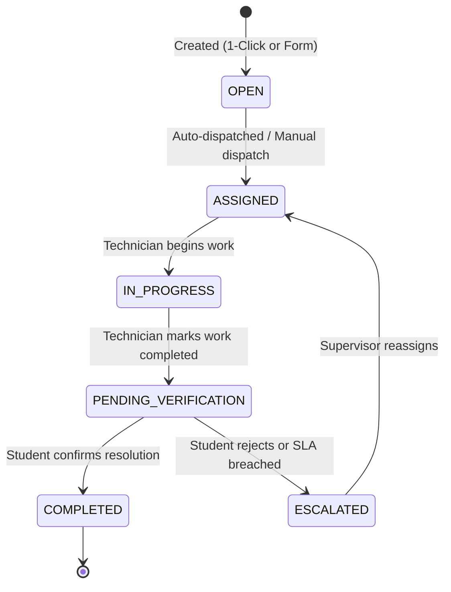

# FIX_MASTER — Complaint Categories, Subcategories & SLA Specification

## 1. Overview & Classification Hierarchy

FIX_MASTER enforces a 2-tier relational classification model (`complaint_categories` → `complaint_subcategories` → `complaints`) designed to support:
1. **1-Click Quick Housekeeping**: Instantly dispatched to on-duty cleaning personnel.
2. **Room Technical Issues**: Structured diagnostic complaints with preferred arrival slots.
3. **Common Area Infrastructure**: Block-wide shared amenity failures (water coolers, lifts, washrooms).

```mermaid
graph TD
    A["Hostel Complaints"] --> B["Housekeeping & Cleaning"]
    A --> C["Electrical & Power"]
    A --> D["AC & HVAC Maintenance"]
    A --> E["Carpentry & Furniture"]
    A --> F["Plumbing & Sanitary"]
    A --> G["Common Area Infrastructure"]

    B --> B1["1-Click Room Cleaning"]
    B --> B2["Balcony & Dusting"]
    B --> B3["Dustbin Clearance"]

    C --> C1["Tube Light / Bulb Failure"]
    C --> C2["Socket Damaged / Sparking"]
    C --> C3["Fan Regulator Failure"]
    C --> C4["Room MCB Tripped"]

    D --> D1["AC Cooling Failure"]
    D --> D2["AC Foul Smell"]
    D --> D3["Water Dripping in Room"]
    D --> D4["AC Remote / Sensor Error"]

    E --> E1["Table / Chair Broken"]
    E --> E2["Cupboard / Almirah Hinge"]
    E --> E3["Door Lock / Latch Jammed"]
    E --> E4["Bed Frame / Ply Cracked"]

    F --> F1["Tap Leaking / Broken Nozzle"]
    F --> F2["Flush Tank Overflow"]
    F --> F3["Drain Clogged"]
    F --> F4["Geyser / Hot Water Fault"]

    G --> G1["Floor Water Cooler Down"]
    G --> G2["Common Washroom Pipe Burst"]
    G --> G3["Elevator / Lift Malfunction"]
    G --> G4["Corridor Lighting Failure"]
```

---

## 2. Master Category & SLA Catalog

### 2.1 CLEANING (Housekeeping & Sanitation)
- **Trade Specialization**: `CLEANING` | **Category Code**: `CAT_CLEAN` | **Default SLA**: 2 to 4 Hours

| Subcategory Code | Issue / Action Name | Priority | SLA (Hours) | Quick Action? | Description |
|---|---|:---:|:---:|:---:|---|
| `CLN_ROOM_SWEEP` | **1-Click Room Cleaning & Mopping** | `LOW` | 2 hrs | Yes | Sweeping and wet mopping of room floor |
| `CLN_DUSTING` | **Room Dusting & Balcony Sweep** | `LOW` | 4 hrs | Yes | Surface dusting, window ledges, balcony sweeping |
| `CLN_TRASH` | **Room Trash / Dustbin Clearance** | `LOW` | 2 hrs | Yes | Emptying room wastebins and disposal |
| `CLN_CORRIDOR` | **Corridor Spillage / Deep Clean** | `MEDIUM` | 3 hrs | No | Urgent corridor liquid cleanup or sanitization |

### 2.2 ELECTRICAL (Electrical & Power Systems)
- **Trade Specialization**: `ELECTRICIAN` | **Category Code**: `CAT_ELEC` | **Default SLA**: 4 to 12 Hours

| Subcategory Code | Issue / Action Name | Priority | SLA (Hours) | Description |
|---|---|:---:|:---:|---|
| `ELEC_LIGHT` | **Tube Light / LED Bulb Failure** | `MEDIUM` | 12 hrs | Light flickering, dead tube, or blown starter |
| `ELEC_SOCKET` | **Power Socket Damaged / Sparking** | `HIGH` | 6 hrs | Loose pins, burning smell, or internal sparking |
| `ELEC_SWITCH` | **Switch Board Loose / Burnt** | `HIGH` | 6 hrs | Cracked faceplate, broken toggle, or burnt switch |
| `ELEC_FAN` | **Fan Regulator Broken / Not Rotating** | `MEDIUM` | 12 hrs | Blown capacitor, fixed speed, or broken regulator knob |
| `ELEC_MCB` | **Room MCB Tripped / Main Power Loss** | `HIGH` | 4 hrs | Miniature circuit breaker continuously tripping |

### 2.3 AC_MAINTENANCE (Air Conditioning & HVAC)
- **Trade Specialization**: `AC_TECH` | **Category Code**: `CAT_AC` | **Default SLA**: 6 to 24 Hours

| Subcategory Code | Issue / Action Name | Priority | SLA (Hours) | Description |
|---|---|:---:|:---:|---|
| `AC_COOLING` | **AC Not Cooling / Weak Airflow** | `MEDIUM` | 24 hrs | Compressor running but air warm; choked filter |
| `AC_SMELL` | **AC Foul / Burning Smell** | `HIGH` | 6 hrs | Moldy odor or electrical insulation odor from vent |
| `AC_LEAKAGE` | **Water Dripping / Leakage Inside Room** | `HIGH` | 12 hrs | Drain pan overflow or condensate line drip |
| `AC_REMOTE` | **AC Remote Lost / Display Error Code** | `LOW` | 24 hrs | Remote unresponsive or panel error code (E1/E4) |
| `AC_NOISE` | **Abnormal Vibrations / Loud Compressor** | `MEDIUM` | 24 hrs | Blower wheel imbalance or outdoor unit shudder |

### 2.4 CARPENTER (Carpentry, Doors & Furniture)
- **Trade Specialization**: `CARPENTER` | **Category Code**: `CAT_CARP` | **Default SLA**: 4 to 24 Hours

| Subcategory Code | Issue / Action Name | Priority | SLA (Hours) | Description |
|---|---|:---:|:---:|---|
| `CARP_DESK_CHAIR` | **Study Table / Chair Leg Broken** | `MEDIUM` | 24 hrs | Backrest loose, wobbly legs, or missing fasteners |
| `CARP_ALMIRAH` | **Almirah / Wardrobe Hinge Broken** | `MEDIUM` | 24 hrs | Door unaligned, shelf detached, or lock jammed |
| `CARP_DOOR_LOCK` | **Room Door Lock / Latch Damaged** | `HIGH` | 4 hrs | Key stuck, deadbolt broken, or latch misaligned |
| `CARP_WINDOW` | **Window Glass Pane / Latch Broken** | `MEDIUM` | 24 hrs | Window stay arm broken or cracked glass pane |
| `CARP_BED` | **Bed Frame / Plywood Base Cracked** | `HIGH` | 12 hrs | Sagging cot ply or fractured steel frame weld |

### 2.5 PLUMBING (Plumbing & Sanitary Fittings)
- **Trade Specialization**: `PLUMBER` | **Category Code**: `CAT_PLUMB` | **Default SLA**: 2 to 12 Hours

| Subcategory Code | Issue / Action Name | Priority | SLA (Hours) | Description |
|---|---|:---:|:---:|---|
| `PLUMB_TAP` | **Water Tap Leaking / Broken Nozzle** | `LOW` | 12 hrs | Continuous drip or stripped tap spindle |
| `PLUMB_FLUSH` | **Flush Tank Overflow / Not Filling** | `MEDIUM` | 8 hrs | Float ball stuck or siphon valve leaking |
| `PLUMB_DRAIN` | **Washbasin / Shower Drain Clogged** | `HIGH` | 6 hrs | Standing water blockage in drain trap |
| `PLUMB_GEYSER` | **Geyser / Hot Water Not Working** | `MEDIUM` | 12 hrs | Blown heating coil or faulty thermostat |
| `PLUMB_SHOWER` | **Shower Head Broken / Low Pressure** | `LOW` | 24 hrs | Calcified nozzles or fractured shower arm |

### 2.6 COMMON_AREA_INFRA (Hostel Block Shared Utilities)
- **Trade Specialization**: Issue-dependent | **Category Code**: `CAT_INFRA` | **Default SLA**: 1 to 8 Hours

| Subcategory Code | Location | Issue Name | Priority | SLA | Assigned Trade |
|---|---|---|:---:|:---:|:---:|
| `INFRA_COOLER_TEMP` | Water Cooler | **No Cold Water / Compressor Trip** | `HIGH` | 8 hrs | `AC_TECH` |
| `INFRA_COOLER_RO` | Water Cooler | **Purifier Filter Choked / Bad Taste** | `HIGH` | 6 hrs | `PLUMBER` |
| `INFRA_WASHROOM_BURST`| Washroom | **Main Pipe Burst / Major Leakage** | `EMERGENCY` | 2 hrs | `PLUMBER` |
| `INFRA_LIFT_FAULT` | Elevator | **Lift Jerking / Sensor Malfunction** | `EMERGENCY` | 1 hr | `ELECTRICIAN` |
| `INFRA_CORRIDOR_LIGHT`| Corridor | **Multiple Tube Lights Blown Out** | `MEDIUM` | 6 hrs | `ELECTRICIAN` |
| `INFRA_FIRE_EXIT` | Emergency Exit | **Fire Exit Jammed / Missing Equipment**| `EMERGENCY` | 2 hrs | `CARPENTER` |

---

## 3. Complaint Lifecycle State Machine

- **Shared Room Model**: When roommates file for the same fault on an active ticket, the system joins the reporter to `complaint_reporters` rather than creating duplicate open tickets.
- **Closed-Loop Verification**: A complaint cannot transition to `COMPLETED` without confirmation from the student who raised it (`sp_confirm_resolution`).
