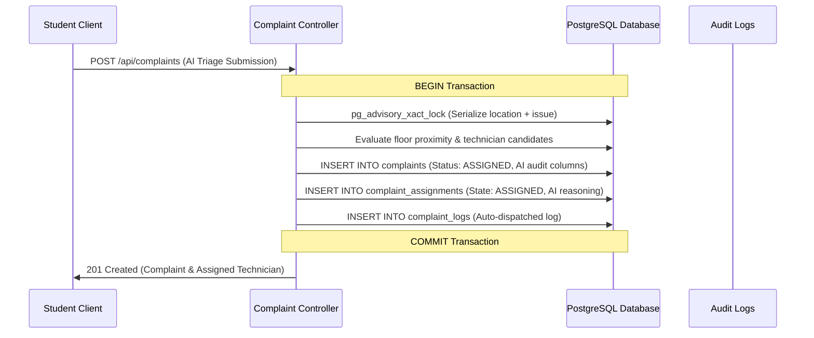

# Database Systems (BCSE307L) Course Report: AI Integration & Relational Impact

> **Focus**: Analysis of how LLM-driven triage and auto-dispatch integrate with relational database constraints, ACID transactions, and 3NF normalization.

---

## 1. Relational Database Design & 3NF Preservation

To record AI-driven reasoning and maintain full audit traceability without violating 3NF, the schema was extended via migration `009_ai_audit_support.sql`:

1. **`complaints` Entity**:
   - `ai_priority_reasoning TEXT`: Explanation generated by the LLM/heuristic matrix justifying priority assignment.
   - `ai_safety_advisory TEXT`: Actionable safety instructions for residents during hazards (e.g., electrical fires, gas leaks).
   - `ai_decided BOOLEAN`: Audit flag distinguishing model-computed decisions from manual supervisor interventions.

2. **`complaint_assignments` Entity**:
   - `ai_allocation_reasoning TEXT`: Rationale recording technician selection criteria (specialization match, floor proximity, active task load).
   - `ai_allocated BOOLEAN`: Distinguishes automated assignments from manual supervisor dispatch.

**3NF Proof**: These attributes depend directly and exclusively on their respective entity primary keys (`complaint_id` and `assignment_id`). No transitive functional dependencies exist across non-key attributes, strictly preserving Third Normal Form.

---

## 2. ACID Transactional Integrity & Automated Dispatch

Automated assignment operations execute within an atomic PostgreSQL transaction so complaints and staff allocations never become desynchronized:

If any constraint fails or no qualified technician is on duty, the transaction aborts via `ROLLBACK`, guaranteeing zero orphaned records or half-assigned complaints.

---

## 3. Concurrency Control & Deadlock Prevention

1. **Transactional Advisory Locks**:
   `pg_advisory_xact_lock(hashtext('complaint-location:...'))` serializes concurrent submissions from roommates in the same room attempting to raise duplicate issues simultaneously.
2. **Deterministic Locking Order**:
   All multi-table operations acquire locks on `complaints` before `complaint_assignments`, preventing cyclic deadlock conditions during concurrent supervisor overrides and automated dispatches.
3. **Optimistic Queue Balancing**:
   Staff allocation queries active workload counts (`ASSIGNED`, `IN_PROGRESS`) joined with technician location, ensuring fair load distribution across personnel within the same trade.
