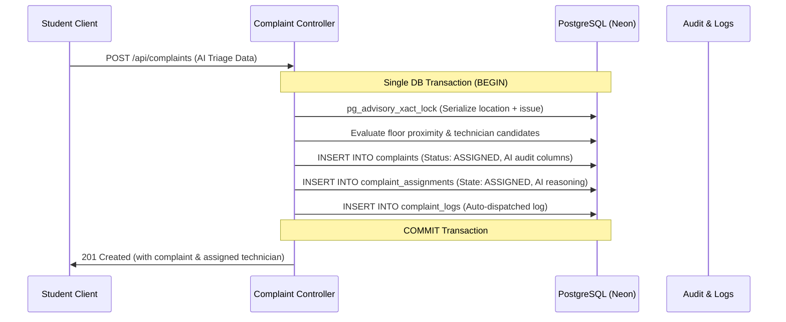

# Database Systems (BCSE307L) Course Report: AI Integration & Relational Impact

**Project:** FixMaster (Smart Hostel Maintenance & Service Dispatch System)  
**Institution:** School of Computer Science & Engineering (SCOPE), VIT Vellore  

---

## 1. Relational Database Design & 3NF Preservation

The AI capabilities in FixMaster were engineered strictly preserving **Third Normal Form (3NF)** and relational integrity without introducing unstructured or unindexed anomalies.

### Audit & Traceability Extensions (Migration `009_ai_audit_support.sql`)
1. **`complaints` Entity**:
   - `ai_priority_reasoning TEXT`: Explanatory rationale generated by the AI or decision matrix explaining *why* a particular priority level was computed.
   - `ai_safety_advisory TEXT`: Actionable safety advice for immediate resident hazards (e.g. electrical sparking or gas leaks).
   - `ai_decided BOOLEAN`: Boolean audit flag distinguishing model-driven decisions from manual supervisor interventions.
2. **`complaint_assignments` Entity**:
   - `ai_allocation_reasoning TEXT`: Audit trail explaining technician selection based on queue length, specialization, and proximity.
   - `ai_allocated BOOLEAN`: Indicates automated vs manual assignment.

Because these attributes describe functional dependencies of the complaint and assignment entities respectively, they reside in their proper tables with zero transitive dependencies, preserving 3NF.

---

## 2. ACID Transactional Integrity & Automated Dispatch

A primary technical requirement was that automated assignment must **never** result in half-completed state:

If an error occurs at any point (e.g., constraint violation or technician unavailability), the transaction aborts via `ROLLBACK`, leaving zero orphan complaints or dangling assignments.

---

## 3. Concurrency Control & Deadlock Prevention

1. **Advisory Locks**: `pg_advisory_xact_lock(hashtext('complaint-location:...'))` serializes simultaneous submissions from roommates in the same room reporting the same fault.
2. **Deterministic Locking Order**: All multi-table updates lock `complaints` before `complaint_assignments`, preventing deadlock cycles during simultaneous supervisor re-assignments and automated dispatches.
3. **Optimistic Queue Balancing**: Workload decisions query live counts of active tasks (`ASSIGNED`, `IN_PROGRESS`) joined with floor numbers, ensuring even load distribution across staff of the same trade.
