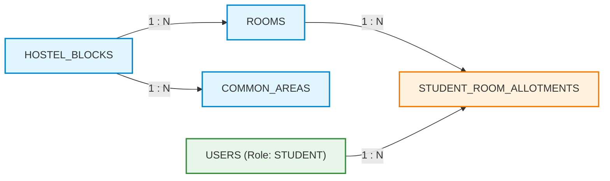
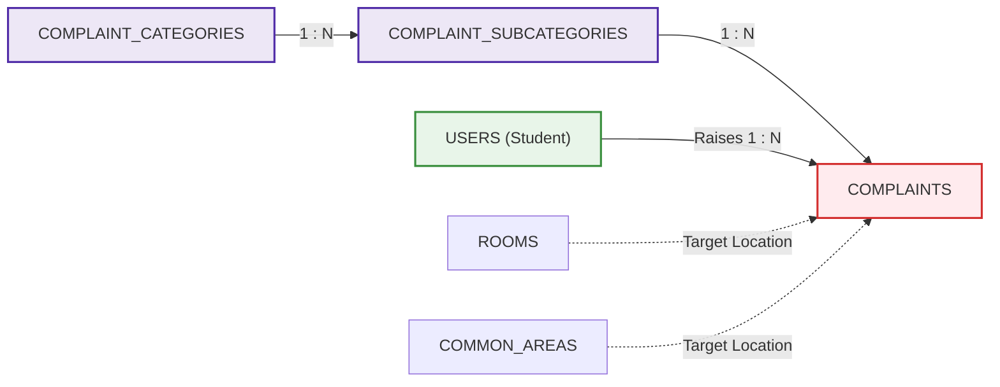
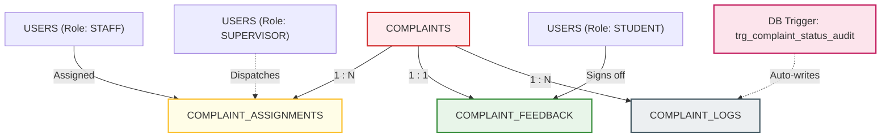

# FIX_MASTER — Entity-Relationship (ER) Models & Diagrammatic Specification

> **Course Code**: BCSE307L – Database Systems | **Topic**: ER Modeling, Relational Dependencies & Normalization Proofs

---

## 1. System Conceptual ER Diagram (Crow's Foot Notation)

Visualizes the 11 core relational entities, primary/foreign keys, and relational cardinalities:

```mermaid
erDiagram
    HOSTEL_BLOCKS ||--|{ ROOMS : "contains (1:N)"
    HOSTEL_BLOCKS ||--o{ COMMON_AREAS : "contains (1:N)"
    HOSTEL_BLOCKS ||--o{ COMPLAINTS : "logged_for (1:N)"

    ROOMS ||--o{ STUDENT_ROOM_ALLOTMENTS : "allotted_in (1:N)"
    ROOMS ||--o{ COMPLAINTS : "target_location (1:N)"

    COMMON_AREAS ||--o{ COMPLAINTS : "target_facility (1:N)"

    USERS ||--o{ STUDENT_ROOM_ALLOTMENTS : "resides_as (1:N)"
    USERS ||--o{ COMPLAINTS : "raises_ticket (1:N)"
    USERS ||--o{ COMPLAINT_ASSIGNMENTS : "assigned_staff (1:N)"
    USERS ||--o{ COMPLAINT_ASSIGNMENTS : "dispatched_by (0:N)"
    USERS ||--o{ COMPLAINT_LOGS : "performed_by (0:N)"
    USERS ||--o{ COMPLAINT_FEEDBACK : "submits_rating (1:N)"

    COMPLAINT_CATEGORIES ||--|{ COMPLAINT_SUBCATEGORIES : "classifies_into (1:N)"
    COMPLAINT_SUBCATEGORIES ||--o{ COMPLAINTS : "specifies_fault (1:N)"

    COMPLAINTS ||--o{ COMPLAINT_ASSIGNMENTS : "routed_to (1:N)"
    COMPLAINTS ||--o| COMPLAINT_FEEDBACK : "verified_via (1:1)"
    COMPLAINTS ||--o{ COMPLAINT_LOGS : "audit_history (1:N)"

    HOSTEL_BLOCKS {
        VARCHAR(10) block_id PK "Block identifier e.g. L_BLOCK"
        VARCHAR(50) block_name "Descriptive name"
        INT total_floors "Total floor count"
        TIMESTAMP created_at "Creation timestamp"
    }

    ROOMS {
        VARCHAR(20) room_id PK "Unique room e.g. L-843"
        VARCHAR(10) block_id FK "References HOSTEL_BLOCKS"
        VARCHAR(10) room_number "Room identifier"
        INT floor_number "Floor index"
        VARCHAR(20) room_type "AC / NON_AC / DELUXE_AC"
        INT bed_capacity "Bed count 1-6"
        BOOLEAN is_active "Operational status"
    }

    COMMON_AREAS {
        VARCHAR(30) area_id PK "Facility asset tag e.g. L-F08-COOLER-01"
        VARCHAR(10) block_id FK "References HOSTEL_BLOCKS"
        INT floor_number "Floor index"
        VARCHAR(50) area_type "COOLER / WASHROOM / LIFT"
        VARCHAR(150) description "Location notes"
        BOOLEAN is_operational "Operational status"
    }

    USERS {
        VARCHAR(36) user_id PK "UUID v4"
        VARCHAR(30) reg_or_emp_id UK "Unique registration or staff ID"
        VARCHAR(100) full_name "User full name"
        VARCHAR(100) email UK "Institutional email"
        VARCHAR(15) phone_number "Contact phone"
        VARCHAR(255) password_hash "BCrypt hashed credentials"
        VARCHAR(20) role "STUDENT / STAFF / SUPERVISOR / ADMIN"
        VARCHAR(30) specialization "Staff trade specialization"
        BOOLEAN is_available "Shift availability flag"
        INT failed_login_count "Consecutive login failures"
        TIMESTAMPTZ locked_until "Account lockout cooling time"
    }

    STUDENT_ROOM_ALLOTMENTS {
        INT allotment_id PK "Auto-increment ID"
        VARCHAR(36) student_id FK "References USERS"
        VARCHAR(20) room_id FK "References ROOMS"
        VARCHAR(20) academic_year "Term e.g. 2026-2027"
        BOOLEAN is_current "Active resident flag"
    }

    COMPLAINT_CATEGORIES {
        INT category_id PK "Auto-increment ID"
        VARCHAR(50) category_code UK "Unique code e.g. CAT_ELEC"
        VARCHAR(100) category_name "Domain name"
        BOOLEAN is_quick_action "Eligible for 1-click dispatch"
        INT default_sla_hours "Default resolution window"
    }

    COMPLAINT_SUBCATEGORIES {
        INT subcategory_id PK "Auto-increment ID"
        INT category_id FK "References COMPLAINT_CATEGORIES"
        VARCHAR(50) subcategory_code UK "Subcategory code e.g. ELEC_SOCKET"
        VARCHAR(100) issue_name "Issue title"
        INT estimated_resolution_mins "Target turnaround"
        VARCHAR(10) priority_level "Default priority level"
        VARCHAR(30) required_specialization "Target staff trade"
    }

    COMPLAINTS {
        VARCHAR(36) complaint_id PK "UUID v4"
        VARCHAR(15) ticket_scope "ROOM / COMMON_AREA"
        VARCHAR(20) room_id FK "Nullable if COMMON_AREA"
        VARCHAR(30) common_area_id FK "Nullable if ROOM"
        VARCHAR(10) block_id FK "References HOSTEL_BLOCKS"
        VARCHAR(36) raised_by_user_id FK "References USERS"
        INT subcategory_id FK "References COMPLAINT_SUBCATEGORIES"
        TEXT description "Detailed problem description"
        VARCHAR(25) status "OPEN / ASSIGNED / IN_PROGRESS / PENDING_VERIFICATION / COMPLETED / ESCALATED"
        VARCHAR(10) priority "LOW / MEDIUM / HIGH / EMERGENCY"
        TEXT ai_priority_reasoning "Audit trail of triage rationale"
        TEXT ai_safety_advisory "Hazard warnings for resident"
        BOOLEAN ai_decided "Automated decision flag"
    }

    COMPLAINT_ASSIGNMENTS {
        INT assignment_id PK "Auto-increment ID"
        VARCHAR(36) complaint_id FK "References COMPLAINTS"
        VARCHAR(36) staff_user_id FK "References USERS"
        VARCHAR(36) assigned_by_user_id FK "Nullable supervisor actor"
        TIMESTAMP assigned_at "Assignment timestamp"
        VARCHAR(20) current_state "ASSIGNED / IN_PROGRESS / DONE"
        TEXT ai_allocation_reasoning "Technician selection rationale"
        BOOLEAN ai_allocated "Auto-allocated flag"
    }

    COMPLAINT_FEEDBACK {
        INT feedback_id PK "Auto-increment ID"
        VARCHAR(36) complaint_id FK "References COMPLAINTS"
        VARCHAR(36) student_id FK "References USERS"
        BOOLEAN is_satisfactorily_resolved "True / False confirmation"
        INT rating "1-5 stars"
        TEXT student_comments "Resident feedback notes"
        TIMESTAMP verified_at "Timestamp of sign-off"
    }

    COMPLAINT_LOGS {
        INT log_id PK "Auto-increment ID"
        VARCHAR(36) complaint_id FK "References COMPLAINTS"
        VARCHAR(36) changed_by_user_id FK "Actor user"
        VARCHAR(25) previous_status "Prior lifecycle state"
        VARCHAR(25) new_status "Next lifecycle state"
        TEXT action_note "Automated or manual audit note"
        TIMESTAMP timestamp "State transition timestamp"
    }
```

---

## 2. Modular Sub-System Architectures

### 2.1 Sub-System 1: Spatial Hierarchy & Resident Allotment
Tracks hostel buildings, floor partitioning, rooms, shared facilities, and student occupancy.

### 2.2 Sub-System 2: Taxonomy Engine & Complaint Classification
Maps service domains, granular fault types, SLAs, required technician trades, and ticket targets.

### 2.3 Sub-System 3: Task Dispatch, Verification & Audit Trail
Handles task routing, status tracking, student sign-off, and automated trigger logging.

---

## 3. Entity Relationships, Cardinalities & Referential Actions

| Parent Entity ($E_1$) | Child Entity ($E_2$) | Cardinality | Foreign Key in $E_2$ | `ON DELETE` | Business Rule Justification |
|---|---|:---:|---|:---:|---|
| `hostel_blocks` | `rooms` | $1 : N$ | `rooms.block_id` | `CASCADE` | Purging a block purges all rooms within it. |
| `hostel_blocks` | `common_areas` | $1 : N$ | `common_areas.block_id` | `CASCADE` | Purging a block purges its shared facilities. |
| `rooms` | `student_room_allotments` | $1 : N$ | `student_room_allotments.room_id` | `RESTRICT` | Cannot drop a room with active residents allotted. |
| `users` | `student_room_allotments` | $1 : N$ | `student_room_allotments.student_id` | `CASCADE` | Deleting a student profile cleans allotment history. |
| `complaint_categories` | `complaint_subcategories` | $1 : N$ | `complaint_subcategories.category_id` | `CASCADE` | Dropping a category drops all child issue types. |
| `complaint_subcategories` | `complaints` | $1 : N$ | `complaints.subcategory_id` | `RESTRICT` | Cannot delete an issue type referenced in active/historical complaints. |
| `users` (Student) | `complaints` | $1 : N$ | `complaints.raised_by_user_id` | `RESTRICT` | Preserves audit trail; users with open/historical complaints cannot be dropped. |
| `complaints` | `complaint_assignments` | $1 : N$ | `complaint_assignments.complaint_id` | `CASCADE` | Deleting a complaint clears its associated dispatch queue entries. |
| `users` (Staff) | `complaint_assignments` | $1 : N$ | `complaint_assignments.staff_user_id` | `RESTRICT` | Cannot delete a staff member with assigned tasks. |
| `complaints` | `complaint_feedback` | $1 : 1$ | `complaint_feedback.complaint_id` | `CASCADE` | Feedback records cascade with the underlying ticket. |
| `complaints` | `complaint_logs` | $1 : N$ | `complaint_logs.complaint_id` | `CASCADE` | Audit log rows cascade with the underlying ticket. |

---

## 4. Normalization Proof (1NF through BCNF)

### 4.1 First Normal Form (1NF)
- **Rule**: Atomic scalar values; no multi-valued attributes or repeating groups.
- **Proof**: Locations are decomposed into discrete scalars (`block_id`, `floor_number`, `room_number`). Status logs and photos are extracted into dedicated child tables (`complaint_logs`, `complaint_reporters`).

### 4.2 Second Normal Form (2NF)
- **Rule**: Table is in 1NF and contains no partial functional dependencies (all non-prime attributes depend on the complete primary key).
- **Proof**: All tables use surrogate single-column primary keys (`user_id`, `complaint_id`, `room_id`, `subcategory_id`, `assignment_id`). No composite primary keys exist with dependent non-key attributes.

### 4.3 Third Normal Form (3NF)
- **Rule**: Table is in 2NF and contains no transitive functional dependencies ($X \rightarrow Y$ and $Y \rightarrow Z$).
- **Proof**: `complaints` references only `subcategory_id`. It does not store `category_id`, `category_name`, or `default_sla_hours`. Similarly, `rooms` stores `floor_number`; `complaints` accesses floor information via FK join on `room_id` without data duplication.

### 4.4 Boyce-Codd Normal Form (BCNF)
- **Rule**: For every non-trivial functional dependency $X \rightarrow Y$, $X$ must be a superkey.
- **Proof**: In every table, all functional determinants (`user_id`, `reg_or_emp_id`, `room_id`, `complaint_id`, `category_id`, `subcategory_id`) are primary or candidate keys.
