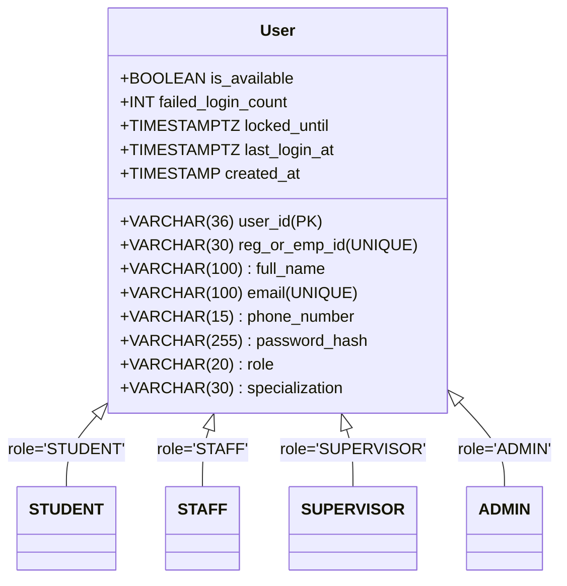

# FIX_MASTER — User Types & Role-Based Access Control (RBAC) Specification

## 1. Architectural Overview

In strict compliance with relational database normalization standards and the BCSE307L course rubric, all system actors reside in a **single, unified `users` table** with a `role` discriminator. Separate entity tables (`students`, `staff`, `admins`) are avoided to preserve single-point identity management, consistent foreign key relationships, and standard authentication workflows.

Role-specific attributes and permissions are enforced via application-level RBAC middleware and relational mapping tables (`student_room_allotments` and `complaint_assignments`).



---

## 2. Detailed User Roles & Profiles

### 2.1 STUDENT (Hostel Resident)
- **Identity**: VIT Registration Number (e.g., `21BCE0843`).
- **Allotment Context**: Linked via `student_room_allotments` to a specific block and room (e.g., `L-843`).
- **Capabilities & Permissions**:
  - **1-Click Quick Action**: Request instant daily housekeeping and room cleaning.
  - **Structured Ticket Raising**: Submit technical issues (Electrical, AC, Carpentry, Plumbing) with description, optional photo proof, and preferred timeslot.
  - **Common Area Reporting**: Report public facility failures (water coolers, washrooms, elevators).
  - **Live Tracking**: Monitor assigned technician details, live status, and contact.
  - **Closed-Loop Verification**: Confirm work completion with 1–5 star rating and feedback.
  - **Audit History**: Access full complaint timeline.

### 2.2 STAFF (Maintenance Personnel & Housekeeping)
- **Identity**: Employee ID (e.g., `EMP_ELEC_01`).
- **Specializations**:
  - `CLEANING`: Housekeeping, sweeping, mopping, dusting, trash clearance.
  - `ELECTRICIAN`: Sockets, wiring, lights, fans, MCBs.
  - `CARPENTER`: Desks, wardrobes, door locks, window latches, beds.
  - `AC_TECH`: Air conditioners, HVAC units, filters, cooling issues.
  - `PLUMBER`: Taps, geysers, flush tanks, drainage, pipes.
- **Capabilities & Permissions**:
  - **Floor-Optimized Task Queue**: View assigned tasks sorted by floor and room to minimize transit time.
  - **Lifecycle Transitions**: Transition tickets (`ASSIGNED` → `IN_PROGRESS` → `PENDING_VERIFICATION`).
  - **Shift Availability**: Toggle `is_available` (`TRUE`/`FALSE`) for auto-dispatch algorithms.
  - **Decline / Escalate**: Flag issues requiring replacement parts or supervisory escalation.

### 2.3 SUPERVISOR (Hostel Block Supervisor / Warden)
- **Identity**: Supervisor ID assigned to a specific hostel block (e.g., `SUP_LBLOCK_01`).
- **Capabilities & Permissions**:
  - **Block Telemetry Dashboard**: Real-time view of open, active, pending, and escalated complaints across all floors.
  - **Common Area Management**: Prioritize shared amenity repairs.
  - **Manual Task Dispatch**: Assign or reassign tickets when staff is bottlenecked, off-duty, or when AI is degraded.
  - **SLA & Defect Monitoring**: Track resolution times, recurring defect hotspots, and staff workload distribution.
  - **Resolution Sign-off**: Close disputed complaints or resolve resident escalations.

### 2.4 ADMIN (Chief Warden / Estates & Maintenance Office)
- **Identity**: System Administrator account (e.g., `ADMIN_ESTATES_01`).
- **Capabilities & Permissions**:
  - **Infrastructure Configuration**: Manage hostel blocks, floors, rooms, bed capacities, and common areas.
  - **User & Allotment Management**: Onboard staff/supervisors, bulk-manage room allotments, and unlock locked accounts.
  - **Category & SLA Master**: Manage complaint categories, subcategories, SLAs, and priority levels.
  - **System Audit & Maintenance**: Access administrative audit logs (`audit_log`), backup/restore database (`pg_dump`/`pg_restore`).

---

## 3. Database Schema Implementation (`users` Table)

```sql
CREATE TABLE users (
    user_id VARCHAR(36) PRIMARY KEY DEFAULT uuid_generate_v4()::text,
    reg_or_emp_id VARCHAR(30) UNIQUE NOT NULL,      -- '21BCE0843' (Student) / 'EMP_ELEC_01' (Staff)
    full_name VARCHAR(100) NOT NULL,
    email VARCHAR(100) UNIQUE NOT NULL,
    phone_number VARCHAR(15) NOT NULL,
    password_hash VARCHAR(255) NOT NULL,           -- BCrypt hash (cost factor 12)
    role VARCHAR(20) NOT NULL CHECK (role IN ('STUDENT', 'STAFF', 'SUPERVISOR', 'ADMIN')),
    specialization VARCHAR(30) CHECK (
        specialization IS NULL OR 
        specialization IN ('CLEANING', 'ELECTRICIAN', 'CARPENTER', 'AC_TECH', 'PLUMBER')
    ),
    is_available BOOLEAN DEFAULT TRUE,
    failed_login_count INT NOT NULL DEFAULT 0 CHECK (failed_login_count >= 0),
    locked_until TIMESTAMPTZ,
    last_login_at TIMESTAMPTZ,
    created_at TIMESTAMP WITH TIME ZONE DEFAULT CURRENT_TIMESTAMP
);

CREATE INDEX idx_users_role_specialization ON users(role, specialization, is_available);
CREATE INDEX idx_users_reg_or_emp_id ON users(reg_or_emp_id);
```

---

## 4. Role-Based Permissions Matrix

| Feature / Action | STUDENT | STAFF | SUPERVISOR | ADMIN | Enforced Via |
|---|:---:|:---:|:---:|:---:|---|
| **1-Click Quick Clean** | Yes | No | No | No | `authorize(['STUDENT'])` |
| **Raise Room Complaint** | Yes | No | No | No | `authorize(['STUDENT'])` + allotment check |
| **Raise Common Area Issue** | Yes | Yes | Yes | Yes | Authenticated JWT |
| **View Assigned Task Queue** | No | Yes | No | No | `authorize(['STAFF'])` + queue filter |
| **Update Task State (Start / Done)** | No | Yes | No | No | `authorize(['STAFF'])` + ownership check |
| **Confirm Resolution & Star Rating** | Yes | No | No | No | `sp_confirm_resolution` raiser check |
| **Block Telemetry & Heatmaps** | No | No | Yes | Yes | `authorize(['SUPERVISOR', 'ADMIN'])` |
| **Manual Dispatch / Reassignment** | No | No | Yes | Yes | `authorize(['SUPERVISOR', 'ADMIN'])` |
| **Manage Blocks, Rooms & Allotments** | No | No | No | Yes | `authorize(['ADMIN'])` |
| **Manage Users & Unlock Accounts** | No | No | No | Yes | `authorize(['ADMIN'])` |
| **View Administrative Audit Logs** | No | No | No | Yes | `authorize(['ADMIN'])` |
